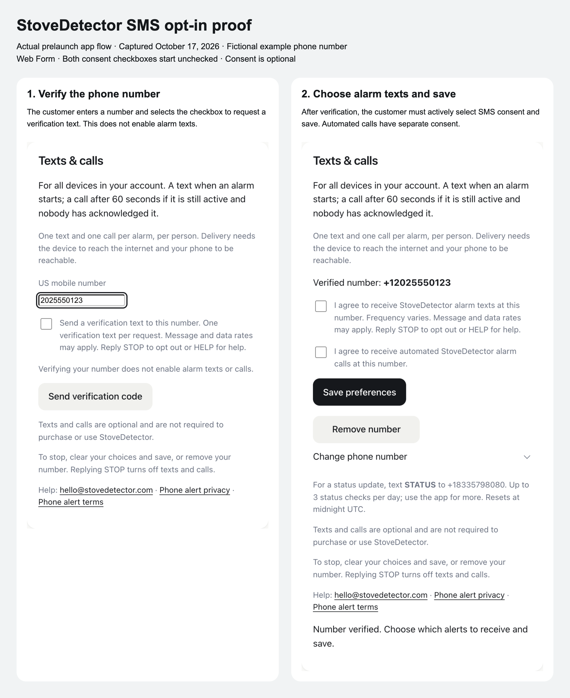
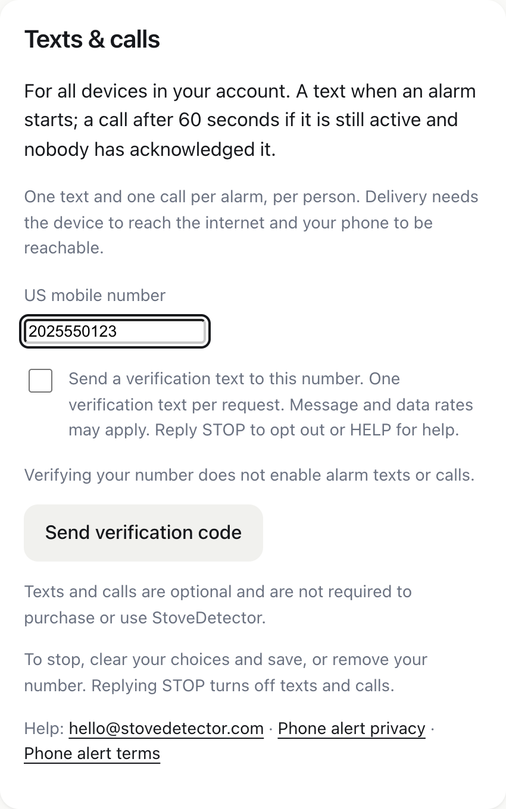
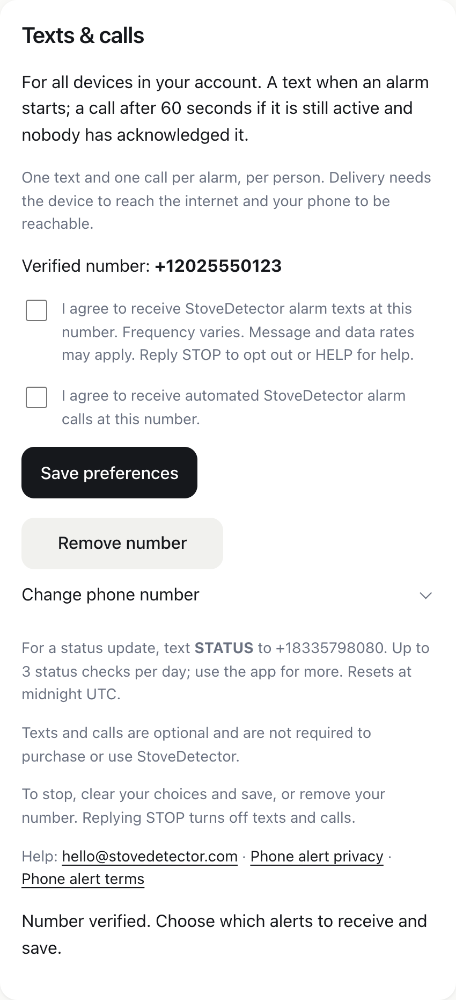
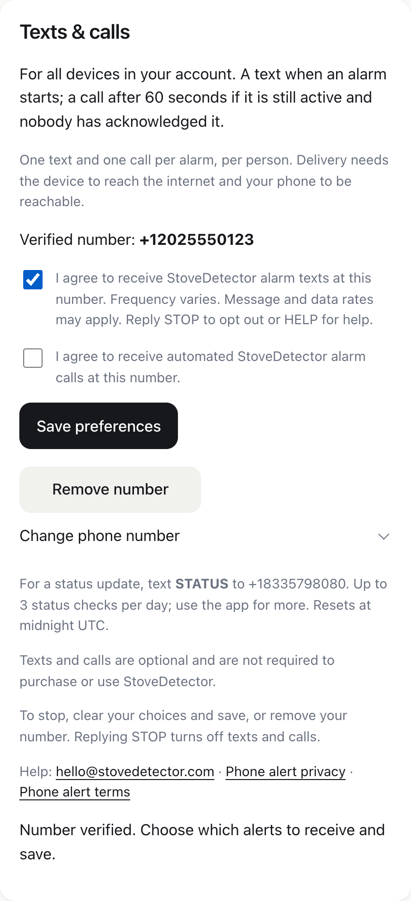
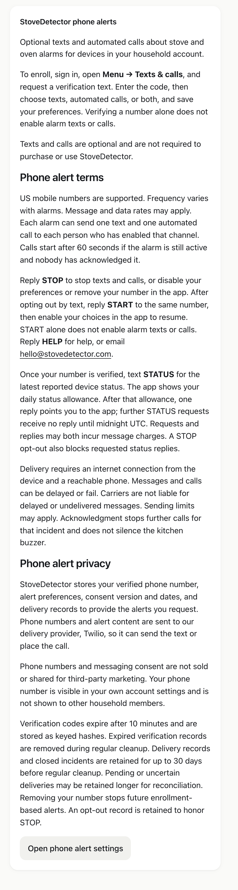

# StoveDetector SMS opt-in proof

Public evidence for toll-free SMS verification of **+1 (833) 579-8080**.

## Feature status

This is the actual prelaunch StoveDetector consent flow, captured on October 17, 2026 from branch `codex/twilio-sms-alerts-20261017`. It is not yet deployed to production. The captures use an example account and the fictional number +1 (202) 555-0123 with a simulated delivery provider. No real customer information appears here.

## Opt-in method: Web Form

Customers sign in to their StoveDetector account and open **Menu → Texts & calls**. Enrollment has two separate steps:

1. Enter a US mobile number, actively select the unchecked verification-text checkbox, and request a verification code. This consent permits the requested verification text; it does not enable alarm notifications.
2. Verify the number using the code, then actively select the separate, initially unchecked SMS alarm consent checkbox and press **Save preferences**. Automated calls have their own optional checkbox. Neither checkbox is preselected.

The form discloses the message purpose, variable alarm frequency, message and data rates, HELP and STOP instructions, and links to phone-alert terms and privacy. Consent is optional and is not required to purchase or use StoveDetector.

## Combined proof

## Full-resolution screenshots

### Step 1: Phone number entry and verification-text consent

### Step 2: Separate alarm consent, initially unchecked

### Step 3: Customer actively selects SMS before saving

## Phone alert terms and privacy

Read the [phone alert terms and privacy policy](PHONE-ALERT-POLICY.md). These are the policy contents for the prelaunch feature shown above. The production `/phone-alerts` route is awaiting deployment.

Contact: hello@stovedetector.com
